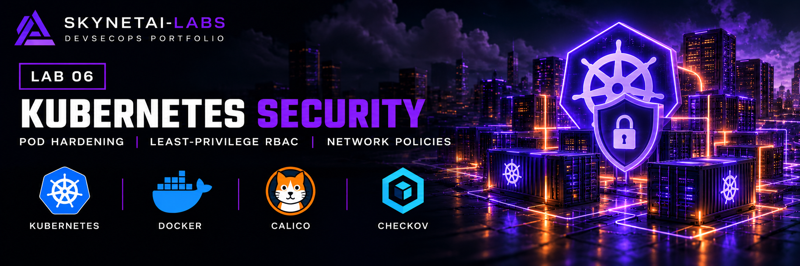
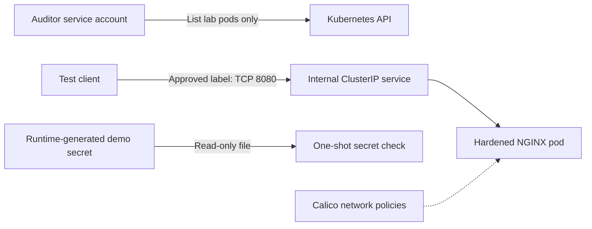

# GitHub DevSecOps Lab 06 — Kubernetes Security

A local Kubernetes security lab covering container hardening, restricted
pod admission, least-privilege RBAC, network-policy enforcement and
file-based secret handling.

## Objectives

- Deploy and verify a hardened web application.
- Test allowed and denied Kubernetes permissions.
- Demonstrate enforced network restrictions.
- Handle a demonstration secret without committing its value.
- Scan manifests, remediate findings and verify cleanup.

## Environment and tools

- Ubuntu on Windows WSL2
- Docker Engine 29.1.3
- kind 0.33.0
- Kubernetes and kubectl 1.35.8
- Calico 3.32.2
- Checkov 3.3.30
- Python 3

The cluster ran locally inside Docker. No AWS resources were created.

## Architecture



The namespace enforces restricted Pod Security Standards.
The auditor role allows get, list and watch on pods in this namespace.
Recorded RBAC tests used administrator impersonation of the auditor service
account, not a separate service-account login. Pod deletion was checked with
`kubectl auth can-i`; no deletion was attempted as the auditor.
Application and test pods do not automatically mount API tokens.

## Security controls

- Image pinned by SHA256 digest.
- Non-root UID/GID 10001 after remediation.
- Read-only container root filesystem.
- All Linux capabilities dropped.
- Privilege escalation disabled and RuntimeDefault seccomp configured.
- CPU and memory requests and limits.
- HTTP readiness and liveness probes on the web deployment.
- Internal ClusterIP service; no public ingress configured.
- Web ingress denied unless the source matches the approved client label.
- Separate ingress-deny policy for the client.
- Demonstration secret mounted as a read-only file.

## Verified results

| Test | Observed result |
|---|---|
| Cluster health | Node Ready; Calico and system pods Running |
| Application rollout | Successful before and after UID remediation |
| Runtime identity | UID/GID 10001 |
| Effective capabilities | Zero |
| NoNewPrivs / Seccomp | 1 / 2 |
| Root filesystem | Read-only verified before UID remediation |
| Automatic API token | Absent before UID remediation |
| Auditor lists lab pods | Allowed |
| Auditor lists secrets | Forbidden |
| Auditor lists system pods | Forbidden |
| Auditor delete-pod authorisation | No |
| Unsafe pod admission | Rejected by server-side dry run |
| Network baseline | HTTP succeeded |
| Web ingress deny | HTTP timed out |
| Approved-client exception | HTTP succeeded |
| Unapproved client label | HTTP timed out |
| Connectivity after UID/client-policy changes | HTTP succeeded |
| Secret-file check | Passed before and after UID remediation |
| Cleanup | kind cluster and node container absent |

Evidence is in [docs/evidence](docs/evidence/).
Early evidence records UID 101; later evidence records the verified change
to UID 10001. Historical evidence is retained.

## Security scanning and remediation

| Checkov scan | Passed | Failed | Skipped |
|---|---:|---:|---:|
| Baseline | 275 | 8 | 0 |
| After remediation | 279 | 4 | 0 |

Remediation changed three workloads to a high UID/GID and added a
network policy selecting the client.

Four probe findings remain on the disposable client and one-shot secret
checker. The application deployment has both HTTP probes.
No findings were suppressed.

See [security findings and evidence limits](docs/security-findings.md).
This scan covers application manifests, not Calico vendor configuration,
container vulnerabilities or a live control-plane compliance audit.

## Reproduction

Prerequisites: Docker access, kind, kubectl and Python 3.
The Docker group grants administrator-equivalent control through Docker.

Run from the repository root:

```bash
kind create cluster --name lab6-security --config cluster/kind-config.yaml
kubectl --context kind-lab6-security apply --server-side -f cluster/calico-v3.32.2.yaml
kubectl --context kind-lab6-security wait --for=condition=Ready nodes --all --timeout=180s
kubectl --context kind-lab6-security apply -f manifests/namespace.yaml
kubectl --context kind-lab6-security apply -f manifests/serviceaccount.yaml -f manifests/rbac.yaml
```

Create the disposable secret without saving its value:

```bash
python3 -c 'import json,secrets; print(json.dumps({"apiVersion":"v1","kind":"Secret","metadata":{"name":"lab6-demo-secret","namespace":"lab6-security"},"type":"Opaque","stringData":{"demo-token":secrets.token_urlsafe(24)}}))' | kubectl --context kind-lab6-security apply -f -
```

Deploy the remaining resources:

```bash
kubectl --context kind-lab6-security apply -f manifests/
kubectl --context kind-lab6-security -n lab6-security rollout status deployment/lab6-web --timeout=180s
```

To reproduce the baseline network test, test connectivity before applying
network policies. Applying all manifests deploys the final policy configuration.

Scan application configuration:

```bash
checkov -d manifests --framework kubernetes --compact --skip-download
```

The recorded final scan returns a failure status for four documented findings.

## Cleanup

```bash
kind delete cluster --name lab6-security
kind get clusters
docker ps -a --filter "label=io.x-k8s.kind.cluster=lab6-security"
```

Deleting the cluster removes its workloads and demonstration secret.
Downloaded images and installed host tools remain.
The recorded lab cluster has already been deleted.

## Problems encountered

- Docker socket access was denied: added the user to the Docker group
  and started a fresh login session.
- The node initially showed NotReady: installed Calico and verified readiness.
- Checkov flagged UID 101: changed workloads to UID/GID 10001 and retested.
- Standalone pod identity changes required deleting and recreating test pods.

## Lessons learned and enterprise relevance

Configuration alone is insufficient evidence: test allowed and denied
behaviour, verify runtime controls and preserve remediation history.

This lab demonstrates workload isolation, restricted audit access,
network segmentation and controlled secret consumption.
Network labels require protected workload-management permissions.
The policy named `deny-web-ingress` selects web pods only; it is not a
namespace-wide default deny. The allow policy permits matching client pods
in the same namespace on TCP 8080. Policies combine additively.
The secret-check pod is not selected by an ingress-deny policy.
The client ingress-deny policy was configured, but inbound blocking to that
client was not separately connection-tested.
Egress restrictions, encrypted Secret storage, image vulnerability scanning
and a live control-plane audit remain outside the verified scope.

## Automation status

GitHub Actions parses the application YAML and runs Checkov 3.3.30.
The parser checks basic document structure; it is not Kubernetes API-schema
validation. CI does not create a cluster or repeat the live security tests.

The latest reviewed [workflow run 39992078320](https://github.com/SkynetAI-Labs/lab-06-kubernetes-security/actions/runs/39992078320)
completed on 23 October 2026 for commit
`ebcbbda3db3fd68e676bda792e909006dc3fbb04`.
YAML parsing passed. Checkov returned 279 passed, 4 failed and 0 skipped.
The job and overall workflow failed because the four documented probe
findings remain open. No findings were suppressed.

## Verified GitHub Actions execution

[Workflow run 39672458309](https://github.com/SkynetAI-Labs/lab-06-kubernetes-security/actions/runs/39672458309)
completed on 21 October 2026.

The workflow reached the scanning step after YAML parsing.
Checkov 3.3.30 reported 279 passed checks, 4 failed and 0 skipped,
matching the local post-remediation scan.

The workflow failed on CKV_K8S_8 and CKV_K8S_9 for the two disposable
test pods. These findings remain documented and unsuppressed.
This was a static CI scan, not a Kubernetes deployment in GitHub Actions.


## Repository audit — 24 October 2026

See the [dated security audit and prioritised recommendations](SECURITY_AUDIT.md) for the reviewed source commit, verification results, open findings and evidence limitations.

